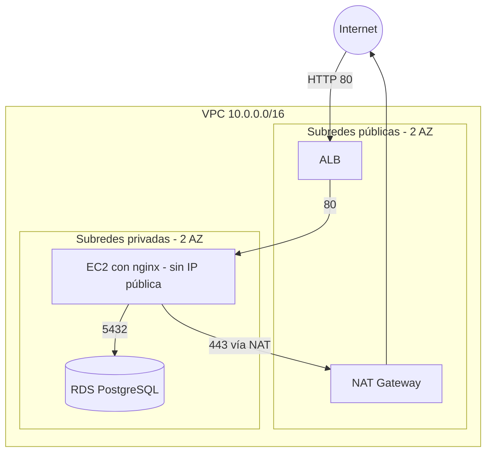

# aws-secur# AWS Secure Cloud Infrastructure

Infraestructura segura en AWS construida con Terraform: red con subredes públicas y privadas, aplicación detrás de un balanceador, base de datos aislada, permisos con mínimo privilegio, auditoría y monitoreo, y un pipeline que revisa la seguridad del código en cada push.

Se desplegó, se probó y se destruyó el mismo día (región `us-east-1`) para no gastar crédito. Todo el código está en `terraform/`.

## Arquitectura



## Qué incluye

| Capa | Servicios | Archivo |
|---|---|---|
| Red | VPC, 2 subredes públicas y 2 privadas en 2 zonas, Internet Gateway, NAT Gateway, tablas de rutas | `vpc.tf` |
| Seguridad de red | Security Groups encadenados: internet → ALB → EC2 → RDS | `security_groups.tf` |
| Permisos | Rol IAM para el EC2 con un único permiso (SSM), sin claves ni SSH | `iam.tf` |
| Aplicación | ALB, EC2 en subred privada, RDS PostgreSQL en subredes privadas | `alb.tf`, `ec2.tf`, `rds.tf` |
| Auditoría | CloudTrail multi-región con validación de integridad, bucket cifrado y sin acceso público | `cloudtrail.tf` |
| Monitoreo | CloudWatch: 3 alarmas (CPU del EC2, CPU de la base, servidor no saludable en el ALB) con aviso por mail vía SNS | `cloudwatch.tf` |
| Cumplimiento | AWS Config con 3 reglas: SSH cerrado, S3 sin lectura pública, RDS no pública | `config.tf` |
| CI | GitHub Actions: `terraform fmt` y `validate`, Checkov y Trivy | `.github/workflows/security.yml` |

El despliegue creó **54 recursos**.

## Decisiones de seguridad

- **Una sola entrada desde internet:** solo el ALB es público. El EC2 y la base están en subredes privadas y sin IP pública.
- **Security Groups encadenados:** el EC2 solo acepta tráfico del ALB y la base solo acepta tráfico del EC2. La base no tiene reglas de salida.
- **Sin SSH:** el acceso al servidor es por Session Manager (SSM). No hay puerto 22 ni llaves.
- **Sin claves dentro del servidor:** el EC2 usa un rol IAM con credenciales temporales.
- **IMDSv2 obligatorio** en el EC2, para reducir el riesgo de robo de credenciales por SSRF.
- **Cifrado:** disco del EC2, base de datos y buckets de S3.
- **Contraseña de la base fuera del código:** la genera AWS y queda en Secrets Manager. También se activó la autenticación IAM en RDS.
- **Buckets** de CloudTrail y Config con el acceso público bloqueado.
- **Datos privados fuera del repo:** el mail de las alertas va en `terraform.tfvars`, que Git ignora.

## Capturas

| | |
|---|---|
| Aplicación funcionando detrás del ALB | 
 |
| Mapa de recursos de la VPC | 
 |
| EC2 sin IP pública |
 |
| Servidor en estado healthy en el ALB | 
|
| Base de datos sin acceso desde internet | 
 |
| Regla de entrada de la base: solo desde la app |
 |
| CloudTrail | 
 |
| Reglas de AWS Config | 
 |
| Alarmas de CloudWatch | 
 |

## Pipeline de seguridad

En cada push y pull request, GitHub Actions corre:

1. `terraform fmt -check` y `terraform validate`.
2. **Checkov**, que analiza la configuración de Terraform.
3. **Trivy**, que busca configuraciones inseguras de severidad alta o crítica.

El pipeline **no despliega nada** y no usa credenciales de AWS. Checkov y Trivy están en modo informativo: muestran los hallazgos pero no cortan la ejecución.

## Riesgos aceptados

Checkov marcó buenas prácticas que no apliqué a propósito, por costo o por simplicidad. En un entorno de producción irían activadas.

| Hallazgo | Por qué lo acepté | En producción |
|---|---|---|
| ALB con HTTP (`CKV_AWS_2`) | HTTPS necesita dominio y certificado | Puerto 443 con ACM |
| Sin protección contra borrado en RDS (`CKV_AWS_293`) | Necesito poder hacer `terraform destroy` | Activada |
| Sin monitoreo detallado en EC2 (`CKV_AWS_126`) | Cobra extra y no aporta para este proyecto | Activado |
| Sin logs de acceso del ALB (`CKV_AWS_91`) | Requiere otro bucket con política propia | Activados |
| CloudTrail sin clave KMS propia ni SNS (`CKV_AWS_35`, `CKV_AWS_252`) | Agrega costo y complejidad. Los registros van cifrados con AES256 y con validación de integridad | KMS propia y notificaciones |
| SNS sin cifrado (`CKV_AWS_26`) | CloudWatch no puede publicar en un topic cifrado con la clave administrada por AWS | Clave propia con política para CloudWatch |
| Una sola AZ para la base y un solo NAT | Ahorro de costo | RDS Multi-AZ y un NAT por zona |
| Un solo servidor EC2 | Simplicidad | Auto Scaling Group (ver mi proyecto de alta disponibilidad) |

## Limitaciones y lo que quedó afuera

- **Security Hub** y **GuardDuty** no se pudieron activar en mi cuenta (`SubscriptionRequiredException`), por eso no están en el proyecto.
- AWS Config detectó un bucket de S3 con lectura pública que **no pertenece a este proyecto** [COMPLETAR: nombre del bucket y por qué es público].
- La base no recibe tráfico real: el proyecto valida la arquitectura y la red, no una aplicación completa.

## Cómo usarlo

Requisitos: Terraform 1.5 o superior, AWS CLI configurado y una cuenta de AWS.

```bash
cd terraform
echo 'alert_email = "tu-mail@ejemplo.com"' > terraform.tfvars
terraform init
terraform plan
terraform apply
```

Al terminar, `terraform output alb_dns_name` muestra la dirección para abrir en el navegador con `http://`.

**Para no pagar de más:**

```bash
terraform destroy
```

El NAT Gateway, el ALB y la base de datos cobran por hora aunque nadie los use.

## Estructura

```
.
├── .github/workflows/security.yml
├── docs/img/
└── terraform/
    ├── main.tf            ├── alb.tf
    ├── variables.tf       ├── ec2.tf
    ├── outputs.tf         ├── rds.tf
    ├── vpc.tf             ├── cloudtrail.tf
    ├── security_groups.tf ├── cloudwatch.tf
    └── iam.tf             └── config.tf
```e-cloud-infrastructure
